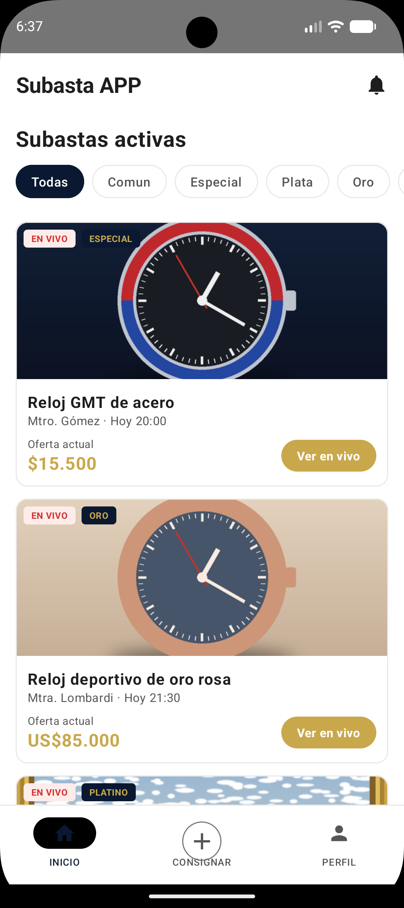
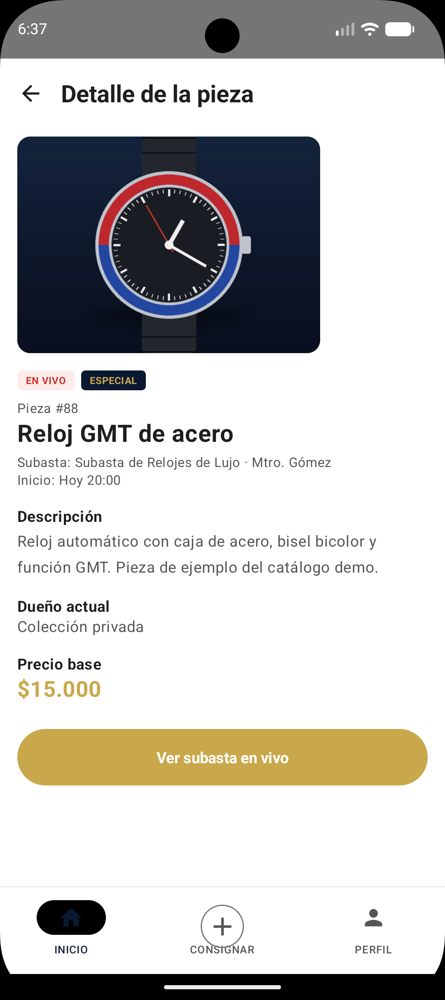
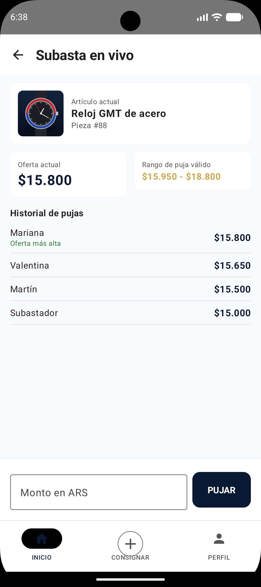
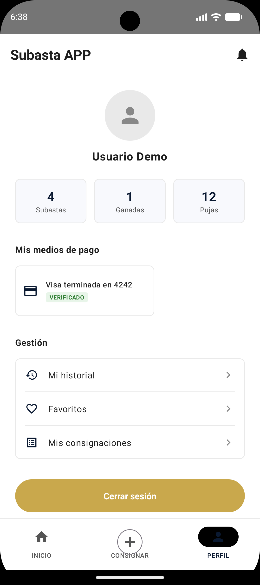
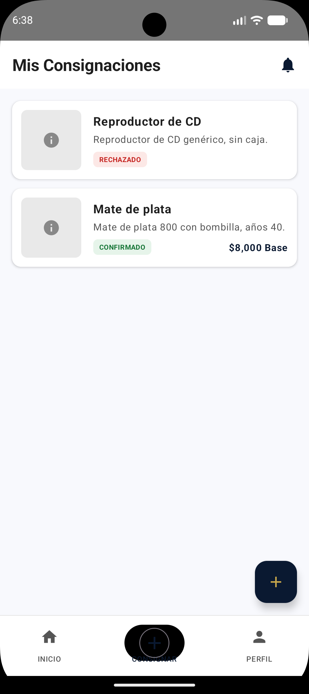

# SubastasApp — TPO Desarrollo de Aplicaciones I

App Android (Kotlin / Jetpack Compose) para participar en subastas, con backend en
Spring Boot (Kotlin + JPA + JWT) y base de datos PostgreSQL.

Los artículos los suben los usuarios (consignación), un administrador los aprueba y se
subastan en fechas definidas. Las pujas se validan en el servidor.

## Capturas (modo demo)

<p>
  
  
  
  
  
</p>

Listado de subastas, detalle de la pieza, subasta en vivo (rango de puja válido e historial),
perfil con medios de pago y consignaciones. Las ilustraciones de las piezas son propias y los datos son ficticios.

## Requisitos
- JDK 17, Docker (o un PostgreSQL 16 propio), Android Studio con un emulador (API ≥ 24).

## Correr todo en local

```bash
# 1) Variables de entorno
cp .env.example .env
#    editar .env: DB_PASSWORD, JWT_SECRET (openssl rand -base64 48), ADMIN_EMAILS

# 2) Base de datos (aplica backend/sql/schema_postgres.sql la primera vez)
docker compose up -d db

# 3) Backend en http://localhost:8080
cd backend
export SPRING_DATASOURCE_PASSWORD=<DB_PASSWORD>  JWT_SECRET=<JWT_SECRET>  ADMIN_EMAILS=admin@demo.local
./gradlew bootRun          # en Windows: gradlew.bat bootRun
```

Sin Docker: crear la base con `psql -U postgres -c "CREATE DATABASE subastasdb;"`,
cargar `backend/sql/schema_postgres.sql` y exportar `SPRING_DATASOURCE_URL`
(por defecto `jdbc:postgresql://localhost:5432/subastasdb`) y `SPRING_DATASOURCE_USERNAME`.

### Datos de demo (opcional, solo local)
Después de la primera vez que arranca el backend (Hibernate crea las columnas y tablas
que faltan):

```bash
docker compose exec -T db psql -U postgres -d subastasdb < backend/sql/seed_demo.sql
```

Crea `cliente@demo.local` / `Demo1234!` (con medio de pago verificado), `admin@demo.local` /
`Admin1234!` y una subasta abierta con un artículo. **No usar en producción.**

### App Android

**Modo demo (por defecto): no necesita backend.** La app funciona sola con datos ficticios en
memoria: subastas con pujas simuladas de otros postores, login con cualquier email/clave,
perfil, medios de pago, consignaciones (el "tasador" las aprueba a los pocos segundos) y
notificaciones. Los datos se pierden al cerrar la app.

Instalar en un teléfono:
```bash
cd frontend
./gradlew :app:assembleDebug     # en Windows: gradlew.bat :app:assembleDebug
# APK: frontend/app/build/outputs/apk/debug/app-debug.apk  -> pasarlo al teléfono e instalarlo
# o, con el teléfono conectado por USB y depuración USB activada:
adb install -r app/build/outputs/apk/debug/app-debug.apk
```

**Con el backend real** (secciones anteriores):
```bash
./gradlew :app:installDebug -PdemoMode=false                                 # emulador -> http://10.0.2.2:8080/
./gradlew :app:installDebug -PdemoMode=false -PsubastasBaseUrl=http://<IP-de-tu-PC>:8080/   # teléfono
```

### Tests del backend
```bash
cd backend && ./gradlew test     # usa H2 en modo PostgreSQL; incluye la prueba de pujas concurrentes
```

## Stack

| Capa              | Tecnología                                                                  |
| ----------------- | --------------------------------------------------------------------------- |
| App móvil         | Android · Kotlin · Jetpack Compose · Retrofit · OkHttp · Coil · DataStore   |
| Backend           | Spring Boot 3.2 · Kotlin · Spring Security + JWT · JPA/Hibernate            |
| Base de datos     | PostgreSQL 16                                                               |
| Actualización de pujas | Polling REST cada 4 s. Hay un endpoint WebSocket/STOMP configurado pero la app no lo usa. |
| Deploy            | Docker (ver `backend/DEPLOY_RENDER.md`)                                     |

## Estructura

```
backend/                 Spring Boot (Kotlin): controllers, services, models JPA
  sql/schema_postgres.sql  Esquema (16 tablas)
  sql/seed_demo.sql        Datos de demo para local
  Dockerfile, DEPLOY_RENDER.md
frontend/                Módulo Android (BASE_URL por -PsubastasBaseUrl)
docker-compose.yml       PostgreSQL (+ backend) para desarrollo
render.yaml              Blueprint de Render
.env.example             Variables de entorno (copiar a .env)
IMPLEMENTACION_SUBASTAS.md / .pdf   Documentación del trabajo
```

## 🔑 Endpoints principales

| Método | Path                                 | Auth    | Qué hace                                  |
| ------ | ------------------------------------ | ------- | ----------------------------------------- |
| POST   | `/auth/register/step1`               | público | Valida datos personales del paso 1        |
| POST   | `/auth/register`                     | público | Crea la persona                           |
| POST   | `/auth/register/step3`               | público | Persiste los medios de pago               |
| POST   | `/auth/login`                        | público | Devuelve JWT                              |
| POST   | `/auth/forgot-password`              | público | Genera código de recuperación             |
| POST   | `/auth/reset-password`               | público | Cambia clave con código                   |
| GET    | `/api/subastas`                      | público | Lista de subastas (item, oferta, moneda…) |
| GET    | `/api/subastas/{id}/detalle`         | público | Detalle de subasta + historial            |
| GET    | `/api/subastas/{id}/pujas`           | público | Historial de pujas (usado por polling)    |
| POST   | `/api/subastas/{id}/pujar`           | JWT     | Registra una puja (valida reglas TPO)     |
| POST   | `/api/consignaciones`                | JWT     | Solicitar consignación de un artículo     |
| GET    | `/api/consignaciones`                | JWT     | Mis consignaciones                        |
| POST   | `/api/consignaciones/{id}/revisar`   | JWT + admin | Aprobar o rechazar (solo `ADMIN_EMAILS`) |
| POST   | `/api/consignaciones/{id}/confirmar` | JWT     | Usuario: aceptar la propuesta del tasador |
| GET    | `/user/profile`                      | JWT     | Datos del usuario logueado                |
| GET    | `/user/metrics`                      | JWT     | Métricas (subastas, ganadas, pujas)       |
| GET    | `/user/payment-methods`              | JWT     | Medios de pago del usuario                |
| GET    | `/api/notificaciones`                | JWT     | Notificaciones                            |
| POST   | `/api/notificaciones/{id}/leida`     | JWT     | Marcar leída                              |
| POST   | `/api/notificaciones/leer-todas`     | JWT     | Marcar todas leídas                       |

La collection de Postman (`Postman_Collection.json`) tiene los más usados con
ejemplo de body.

## ⚙️ Reglas de puja (resumen del TPO)

- Puja mínima = `oferta_actual + 1% · valor_base`
- Puja máxima = `oferta_actual + 20% · valor_base`
- Categorías **Oro** y **Platino**: exentas de límites, solo deben **superar** la oferta actual
- Solo el usuario con su categoría ≥ a la de la subasta y con medio de pago verificado puede pujar
- Se acepta una puja por vez: la UI bloquea “Pujar” hasta recibir la confirmación del backend

## ⚙️ Reglas de puja

- Puja mínima = `oferta_actual + 1% · valor_base`; máxima = `oferta_actual + 20% · valor_base`.
- Categorías **Oro** y **Platino**: sin límites, solo deben superar la oferta actual.
- Solo puede pujar un cliente admitido, con categoría ≥ la de la subasta y un medio de pago verificado.
- La puja se registra en una transacción que bloquea el ítem (`SELECT ... FOR UPDATE`), así que dos
  pujas simultáneas del mismo importe no pueden ganar a la vez. Cubierto por `PujaServiceTest`.
- Los clientes nuevos arrancan en categoría `comun`.

## Seguridad

- Sin claves en el repo: base de datos y `JWT_SECRET` se leen del entorno y no tienen valor por defecto.
- Recuperación de contraseña: código aleatorio (`SecureRandom`) de 15 min, máx. 5 intentos, un código activo por email.
- Revisar consignaciones requiere que el email esté en `ADMIN_EMAILS`.
- La app Android permite tráfico HTTP (`usesCleartextTraffic`) para hablar con el backend local; para producción usar HTTPS y quitarlo.

## 📄 Documentación

- [`IMPLEMENTACION_SUBASTAS.md`](IMPLEMENTACION_SUBASTAS.md) — qué se implementó y qué quedó pendiente
- [`backend/DEPLOY_RENDER.md`](backend/DEPLOY_RENDER.md) — deploy
- `Postman_Collection.json` — ejemplos de requests (definir las variables `email`, `password`, `token`)
